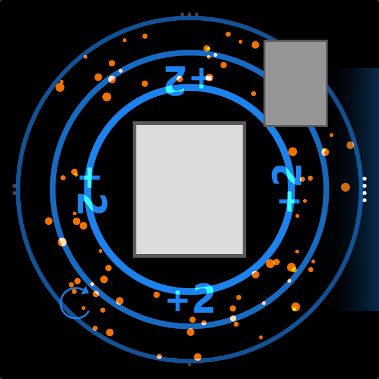
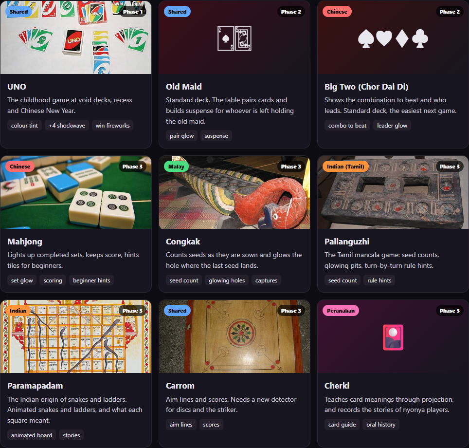
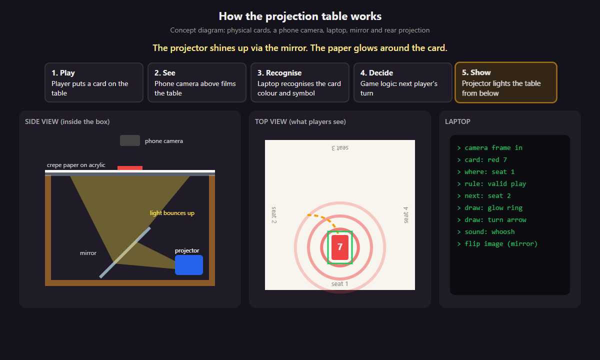

# Uno Dos Tres

An interactive UNO table by **team Uno Dos Tres**, built for the COMMON GROUND Makeathon. Physical cards are the controller; the table responds with projected colour, animation, and sound.

<p align="center"></p>

*Effects mockup from our design document, not a photograph of the physical table or evidence of camera recognition.*

The project has two entry points:

| Mode | Purpose |
|---|---|
| Browser bridge (`bridge/server.py`) | Live camera preview, projected-dot calibration, card-triggered effects, and a phone remote. Uses a simple turn sequence, not the full UNO rules engine. |
| Python app (`main.py`) | Four-player UNO rules, turn tracking, card counts, UNO penalties, undo, and a projected HUD. |

## Why we are building Uno Dos Tres

We want technology to give people a reason to sit down and play together. The idea starts with memories of UNO at school recess, void decks, chalets, and family gatherings: shared games where the conversation and reactions matter as much as winning.

Uno Dos Tres brings digital effects into that physical experience. Players still hold real cards, sit around the same table, and interact with one another. The camera and projector are intended to make the table respond to their moves, without asking each player to use a separate screen or learn a new app. UNO is our first prototype because it gives us a familiar game through which to explore that interaction.

Our longer-term purpose is to help people share the games, rules, and stories passed down through Singapore's communities. We imagine grandparents teaching grandchildren, friends introducing games from their own families, and community spaces using one table to support those exchanges. Light, sound, and turn-by-turn guidance could help newcomers join in while experienced players share what they know.

### Beyond UNO: the roadmap

| Phase | Direction | Status |
|---|---|---|
| 1. UNO | Physical cards with projected reactions, sound, and camera input | Current prototype |
| 2. More card games | Extend the interaction to Old Maid and Big Two | Planned |
| 3. Heritage games | Explore congkak, pallanguzhi, mahjong, carrom, paramapadam, and cherki, with detection and guidance suited to each game | Planned; requires new game logic and, where needed, new detectors |
| 4. A living archive | Preserve rules, family variations, histories, and elders' explanations in their own voices and dialects | Long-term ambition |

The proposed preservation process is to record how people play, translate the rules into game guidance, and let another generation learn through playing together. These heritage-game and archive features are a roadmap, not capabilities implemented in this repository today.

<details>
<summary><strong>Pictures: games we want to support</strong></summary>



These are proposed interactions, not implemented game support. The gallery combines game photographs and illustrations from our project document. See [image sources and credits](docs/images/CREDITS.md) for authors, source links, and licenses.

</details>

## How the table works



*Concept diagram adapted from the supplied project document. The player-position and rules output illustrates the intended interaction; it does not demonstrate automatic seat recognition. The browser bridge provides effects and a simple turn sequence, while the Python app contains the rules engine.*

1. A player places a real card in the discard area.
2. A phone above the table sends video to the laptop through DroidCam.
3. Calibration maps the camera image to the tabletop. The current pipeline checks the card's colour and number/action symbol within the detection zone.
4. An accepted reading triggers the matching effect. In the Python app, game logic also validates the play and updates turns.
5. A projector inside the table shines through a mirror onto the underside of the screen. Effects appear around the cards, keeping the physical play area readable.

The physical design combines a frame, acrylic and a diffusing screen, a mirror, a phone, a laptop, and a home projector. The aim is a shared surface people can play around using ordinary cards.

## Setup

Use a Windows laptop, a phone connected through DroidCam, and a projector configured as an extended display. Confirm that the DroidCam Windows client shows live video before opening the camera in this app.

From the repository root:

```powershell
python -m venv .venv
.\.venv\Scripts\python.exe -m pip install -r requirements.txt
.\.venv\Scripts\python.exe main.py --probe
```

Use the camera index reported for DroidCam. The current setup uses index `2` and the MSMF backend; another machine may use a different index. Close other apps that are using the same camera.

**Current portability limitation:** `bridge/server.py` has an `APP` path pointing to the original developer's checkout. Before running the bridge on another machine, change `APP` to your repository path, for example `APP = HERE.parent`. The bundled `bridge/start.ps1` also uses that developer's Python environment; use the commands below with your own virtual environment instead.

## Camera and projector bridge

```powershell
.\.venv\Scripts\python.exe bridge/server.py --camera 2 --port 8765 --host 127.0.0.1
```

1. Open [Projector](http://127.0.0.1:8765/projector) on the projector display. Click its start screen to enable audio.
2. Set position, size, rotation, mirroring, and fullscreen before calibration. Press `H` to hide the help panel.
3. Open [Controls](http://127.0.0.1:8765/controls) on the laptop. Check that the preview shows the real table.
4. Click **Calibrate projected dots**. Click the centre of each projected dot in the camera preview, in order, four times. Use the dots, not the table corners.
5. Remove cards from the detection area. Click **Start detection** and let the app learn the empty zone.
6. Place one face-up card fully inside the cyan outline. Accepted colour-and-symbol readings update the last-card display and trigger projector effects.

Moving, resizing, rotating, mirroring, changing fullscreen, or using a test pattern invalidates browser calibration. Recalibrate afterwards. Browser calibration lasts for the server session. Keep one projector page open. Stop the server with `Ctrl+C`.

### Browser controls

Click the projector page before using its keyboard controls.

| Key | Action |
|---|---|
| `F` / `H` | Fullscreen / show or hide help |
| Arrows / `+` / `-` | Move / resize projection |
| `O` / `M` | Rotate / mirror |
| `G` / `T` | Test pattern / theme |
| `1 2 3 4` | Red / blue / green / yellow effects |
| `S R Z X W` | Skip / reverse / +2 / +4 / wild |
| `U D V` | UNO / draw / win |
| `A` | Toggle the automatic tour through effects; unavailable while camera detection is armed or calibration is active |
| `Q` | Toggle sound |

The separately prepared video demo where each `A` press advances **green 7 → blue 7 → blue +2** is a local demo build. It is **not included in this GitHub version**.

### Camera-free effects and phone remote

```powershell
.\.venv\Scripts\python.exe bridge/server.py --no-camera --port 8765 --host 127.0.0.1
```

Open the projector and click its start screen, then use its manual keys or [Remote](http://127.0.0.1:8765/remote). Controls offers **Auto**, **Manual**, and **Both** input modes. Manual pauses camera recognition; Auto rejects remote input.

For a phone on the same trusted Wi-Fi, start with `--host 0.0.0.0` and use the laptop's Wi-Fi address shown by the server. The remote and camera preview have no login; avoid exposing this port to the internet. Events sent before projector startup or reconnect are not replayed.

## Current recognition behavior and limits

- The calibrated detection zone is sent directly to recognition. Card-outline extraction is bypassed.
- `STILL_SECONDS = 0.0`: recognition does not wait for stillness. Zone-change checks and the one-second accepted-read cooldown remain.
- A play requires compatible **colour and number/action symbol** evidence. Darkness alone never identifies a Wild card. Wild and +4 require a recognized symbol and multiple hues.
- Unknown or conflicting readings do not advance play. Projected light and background colours can interfere with classification of the full zone.
- `models/symbols.pt` is a YOLOv8n classification candidate trained on the supplied deck photos. Its recorded diagnostic validation at confidence `0.6` contains **15 correct accepted predictions, 2 incorrect, and 10 abstentions out of 27**. This was not an independent real-world test. See [model provenance](models/symbols.provenance.json).
- Physical testing encountered missed detections. Reliable live card-to-effect operation is not established. Manual effects remain available for demonstrations; they do not validate camera accuracy.

Backend and headless browser checks cover calibration, event delivery, and effect mapping. The direct-zone bypass was checked with mocked recognition and duplicate-frame suppression. These checks do not establish physical projection alignment, speaker output, or live recognition accuracy.

## Python rules-engine app

```powershell
.\.venv\Scripts\python.exe main.py --camera 2
.\.venv\Scripts\python.exe main.py --projector --camera 2
```

Configure projector dimensions and screen position in `config.py`. In projector mode, place the square over the table, press `C`, click the four projected dots in the Camera window, and press Enter. Press `S` to save placement. Keep the discard area empty when learning its reference.

| Key | Python app action |
|---|---|
| `C` / Space | Calibrate / relearn empty discard zone |
| `R Y G B W` | Manual red / yellow / green / blue / wild |
| `1 2 3 4` | Manual skip / +2 / reverse / wild +4 |
| `U` / `D` | Call UNO / draw and pass |
| `Z` / `N` | Undo / start a new game |
| `V` | Manual win effect |
| Arrows or `I J K L` | Move projection |
| `+ -` / `O` / `X` / `F` / `S` | Resize / rotate / mirror / fullscreen / save |
| `H` / `Q` or Esc | Help / quit |

Browser and Python shortcuts differ. See [MANUAL.md](MANUAL.md) and [rules.md](rules.md) for the game flow and enforced rules.

## Models and credits

This project builds on pretrained models and open-source work. We did not create the YOLO architecture or train the original UNO detector from scratch.

| Model / component | Credit and source | How we use it |
|---|---|---|
| Ultralytics YOLOv8 and `yolov8n-cls.pt` | [Ultralytics](https://github.com/ultralytics/ultralytics), [YOLOv8 documentation](https://docs.ultralytics.com/models/yolov8/) | Provides the model framework and pretrained classification checkpoint used as the starting point for our deck-specific symbol training. |
| Pretrained UNO detector, stored here as `models/best_train2.pt` | [Stormynova / Uno_Card_detection](https://github.com/Stormynova/Uno_Card_detection) | The original UNO card detector credited in `yolo_symbol.py`. Retained as the fallback when our symbol classifier is unavailable. |
| Deck-specific classifier, `models/symbols.pt` | Our fine-tuned YOLOv8n classifier; [training provenance](models/symbols.provenance.json) | Trained on our supplied UNO deck photos to recognize numbers and action symbols. Used first when available, together with OpenCV-based colour checks. |

The supplied detector notes identify the original checkpoint as [`UNO_Card_Detection_YOLOv8/train2/weights/best.pt`](https://github.com/Stormynova/Uno_Card_detection/blob/main/UNO_Card_Detection_YOLOv8/train2/weights/best.pt), saved here as `models/best_train2.pt`. They credit the upstream dataset to [Ivan Moskalev's `unocardmodel_v3`, version 3, on Roboflow](https://universe.roboflow.com/ivan-moskalev-uwzkq/unocardmodel_v3/dataset/3). This dataset attribution comes from the supplied project document; our deck-specific classifier uses our own photographed samples.

The early detector notes describe 7 detected cards across 5 still images and an approximately 70 ms/frame OpenVINO experiment. Those are historical results for a separate detector experiment, not accuracy or latency measurements of this repository's current live bridge. OpenVINO is not the current bridge's inference backend.

Thank you to Ultralytics and the contributors to Stormynova's UNO detector for making their work available. Our contribution is the physical-table integration, camera/projector calibration, joint colour-and-symbol checks, deck-specific fine-tuning, game logic, and projected interactions.

For upstream terms and attribution, see the [Ultralytics license](https://github.com/ultralytics/ultralytics/blob/main/LICENSE) and the [UNO detector repository's license](https://github.com/Stormynova/Uno_Card_detection/blob/main/LICENSE). These are separate upstream projects; crediting them does not relicense their work.

## Training and project files

Collect labelled samples with `python main.py --collect LABEL`, where `LABEL` is `0`–`9`, `skip`, `reverse`, `draw2`, `wild`, or `wild4`. With outline extraction disabled, captured images contain the detection zone. Review and prepare samples before training with `python train_symbols.py`; training can replace the current classifier.

| File | Role |
|---|---|
| `config.py` | Camera, detection, colour, sound, and projector settings |
| `detector.py`, `yolo_symbol.py` | Zone-change detection and joint colour/symbol recognition |
| `calibration.py` | Camera-to-table mapping |
| `bridge/` | Browser projector, controls, remote, and HTTP bridge |
| `main.py`, `game.py`, `hud.py` | Python app, UNO rules, and player HUD |
| `projector.py`, `reactions.py`, `sound.py` | Projection placement, effects, and audio |
| `models/` | Classifier, fallback detector, and model provenance |

The physical design uses a 50 × 50 cm tabletop with 4 × 4 cm corner posts. Corner keep-out areas prevent projection over the posts; calibration dots sit inside those boundaries. Adjust the geometry in `config.py` for a different table.

## Visual credits

The diagrams, effects mockup, and roadmap gallery were adapted from the team's supplied project document. Photographs retain their original creator credits. See [image sources and licenses](docs/images/CREDITS.md).
